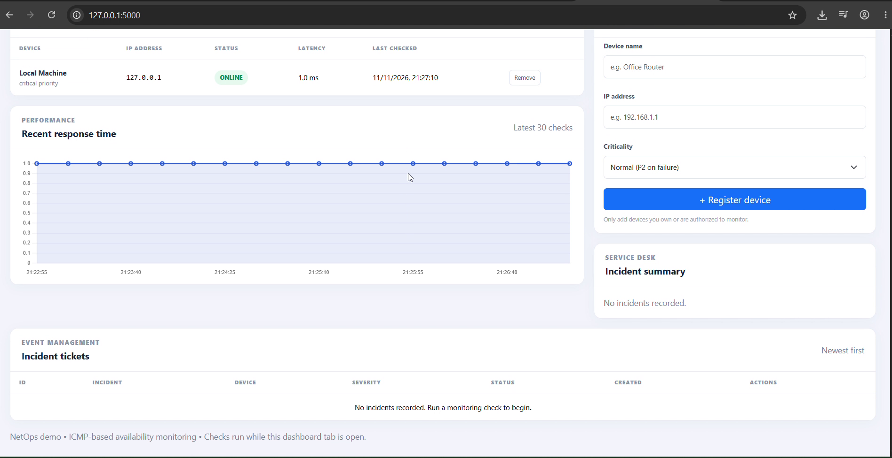

## NetOps — Network Monitoring & Incident Management System

A learning/demo network operations dashboard built with Python, Flask, SQLite, Bootstrap and Chart.js.

## Dashboard Preview



## Features
- Register IPv4/IPv6 devices with normal or critical priority.
- Check device reachability using ICMP ping and record approximate response time.
- Store monitoring history in SQLite.
- Automatically create P1 incidents for critical devices and P2 incidents for normal devices when unreachable.
- Avoid duplicate active incidents for the same device.
- Automatically resolve an active incident after a previously offline device responds again.
- Acknowledge or manually resolve incidents.
- View device status, recent latency history and incident records.

## Run on Windows
1. Install Python 3.10+.
2. Open Command Prompt in this folder.
3. Run:
   ```bat
   python -m venv venv
   venv\Scripts\activate
   pip install -r requirements.txt
   python app.py
   ```
4. Open http://127.0.0.1:5000.

The SQLite database is created automatically. `127.0.0.1` is preloaded as a safe local test target.

## Test
1. Confirm Local Machine reports online.
2. Add an IP address you own or are authorized to monitor, such as your LAN router.
3. Click **Run checks now** or leave the dashboard tab open; it polls every 15 seconds.
4. To simulate an outage, add an unused private LAN IP that you have verified is not assigned. A failed check should create an incident.
5. When a previously offline device responds again, its active incident is automatically resolved. You can also acknowledge or resolve incidents manually.

Do not scan or monitor networks without permission.

## API
| Method | Endpoint | Purpose |
|---|---|---|
| GET | `/api/dashboard` | Dashboard data |
| POST | `/api/devices` | Register device |
| POST | `/api/monitor` | Run a monitoring cycle |
| PATCH | `/api/incidents/<id>` | Acknowledge or resolve |
| DELETE | `/api/devices/<id>` | Delete device and history |

## Limitations
- Monitoring is triggered by the open browser dashboard every 15 seconds; it is not a background service when the tab is closed.
- ICMP confirms IP reachability only. It does not establish that a device's application or service is healthy.
- Some hosts/firewalls block ping even when services are working.
- Severity is a simple device-criticality rule, not a full ITIL impact/urgency matrix.
- This demo does not include authentication, SNMP, email/SMS notifications, role-based access, or a production SLA engine.

## Interview summary
"I built a Flask-based network monitoring and incident management demo. It checks registered devices using ICMP ping, records reachability and response time in SQLite, creates incidents when devices become unreachable, assigns a configurable severity based on device criticality, and tracks acknowledgement and resolution. The dashboard refreshes monitoring data every 15 seconds while it is open."
